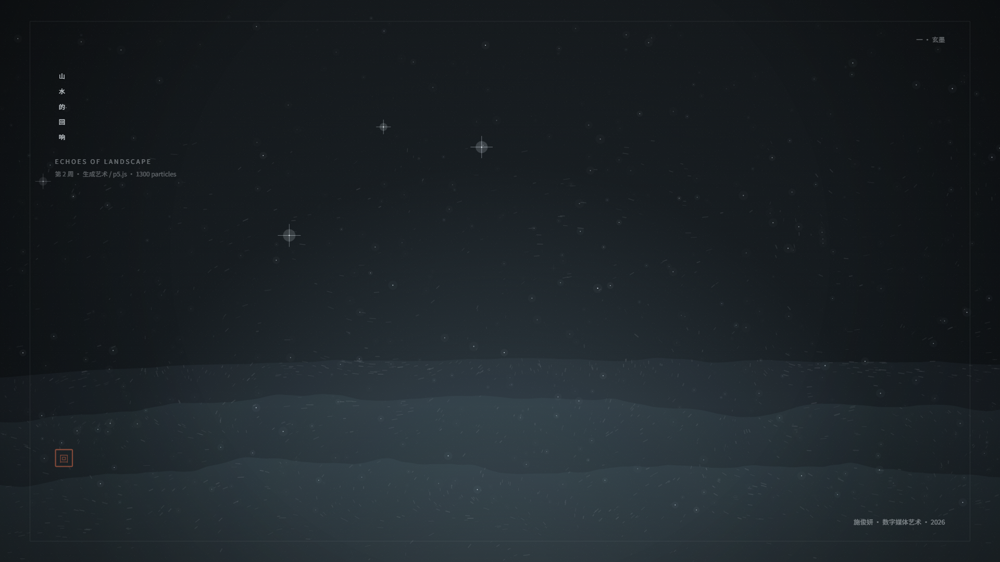

# 第二周｜会动的数字海报《山水的回响》

网页链接：https://lulu-phoebe.github.io/echo-landscape/
GitHub 仓库：https://github.com/lulu-phoebe/echo-landscape

施俊妍 · 数字媒体艺术 · 第 2 周任务

---

## 案例研究

**OpenProcessing**

particles
① perlin noise 2 — https://openprocessing.org/sketch/1618295
作者：Anh Nguyen
② Swirling effect — https://openprocessing.org/sketch/1975215/
作者：Gonçalo Perdigão
③ Image Trail Effects — https://tympanus.net/Development/ImageTrailEffects/index2.html
作者：Manoela Ilic / Codrops（鼠标轨迹类，看它的"按位移出图"机制）

noise / flow field
④ perlin noise 2（同上，重点看噪波的时间维）
⑤ Swirling effect（同上，重点看粒子跟随同一连续场）

---

## 案例分析卡

**卡 01**

| 作品名称 / 链接 | perlin noise 2 — https://openprocessing.org/sketch/1618295 |
|---|---|
| 作者 / 出处平台 | Anh Nguyen / OpenProcessing |
| 技术拆解 | p5.js 二维 Canvas + 三维 Perlin 噪波。粒子运动方向取自噪波场，同一片区域方向连续，粒子会"结伴"流动，而不是各自乱走；噪波的第三维是时间，让流场缓慢转向。 |
| 表现拆解 | 空间连续的噪波使附近线段朝向相关，整片画面像被风吹过的草；时间维的缓慢变化让"风"有方向上的转移，不是匀速抖动。 |
| 可借鉴点 | 把鼠标位置作为噪波输入的一个偏移量，让观众"推"这阵风；但要限制偏移幅度，否则流场会被推乱、丢掉整体方向。 |
| TD 对照 | 方向纹理 ≈ Noise TOP 驱动 Geometry COMP 的实例旋转；时间维 ≈ 给 Noise TOP 的第三个输入接 `absTime`。 |

**卡 02**

| 作品名称 / 链接 | Swirling effect — https://openprocessing.org/sketch/1975215/ |
|---|---|
| 作者 / 出处平台 | Gonçalo Perdigão / OpenProcessing |
| 技术拆解 | 二维 Canvas + Perlin 流场 + 粒子对象数组；每帧更新位置并连线，旧轨迹靠逐帧半透明覆盖缓慢衰减。 |
| 表现拆解 | 粒子跟随同一个连续场，局部运动汇成旋流，形成"有组织的变化"——不是随机，是秩序里的流动。 |
| 可借鉴点 | 只保留一条很淡的旧轨迹（不是清屏），让运动留下"余像"，这正是水墨需要的呼吸感。 |
| TD 对照 | flow field ≈ Noise TOP 生成方向场；余像 ≈ Feedback TOP + Level TOP 衰减（0.98 左右）。 |

---

## 练习进度

**第一次提示词**

> 做一个 p5.js 的"会动的数字海报"，主题「山水 / 回响」。要有粒子或噪波系统（≥500 粒子），鼠标能影响画面，三套配色可切换，画面里要有主题文字，按 S 能导出 PNG。整体走水墨、留白、安静的路子，不要霓虹渐变。

效果：能跑，但粒子的运动像"划痕"，不是"墨"。

**第二次提示词**

> 粒子太像毛发了：每帧画的线段太短、透明度太散。改成先让粒子沿流场走，再用"低透明度 + 每帧轻微褪色"累积成雾，别清屏重画。

效果：墨的质感对了，但鼠标一停就堆出一团黑斑。

**第三次提示词**

> 鼠标不应该在纸上留东西。它只负责"风"：靠近时把粒子推开，离开后画面自己恢复。点击才留痕迹。

效果：干净了，但整体太"平"，没有视觉焦点。

**第四次提示词**

> 要大气、简洁，但要有光在闪（不灵不灵的那种），颜色要高级——不要纯黑纯白，要带灰的冷调。

效果：加了星尘和星芒，构图改成"夜 + 雾海"。

**第五次提示词**

> 不要大字标题，字一大就俗。标题缩小成竖排放在左上，把气势交给画面本身。

效果：定稿。

---

## 技术说明

- 框架：p5.js 1.9.4（本地文件，无 CDN，断网可跑）
- 粒子：1300 个，沿 Perlin 风场漂移，每帧按速度方向画 4 倍长度的短笔触
- 墨层：独立 `p5.Graphics`，`destination-out` 每帧褪色 0.28%，笔触累积成雾，不清屏
- 星尘：约 190 颗，`blendMode(ADD)` 双层圆 + 16 组十字星芒，正弦相位错开闪烁
- 山体：三层噪声山脊，粒子绑定到某一层，只在山体内活动
- 导出：`saveCanvas()`，导出时隐藏提示，控制栏在 HTML 层不进图
- 交互：鼠标位置 → 径向风场；轨迹 → 延迟 16/34/56 帧回放（三次回声）；点击 → 墨环 + 30 粒光尘；按钮/1·2·3 → 换墨色；S → 存图

**配色出处**

| 编号 | 名称 | 底 / 墨 / 雾 | 出处 |
|---|---|---|---|
| 一 | 玄墨 | `#080A0C` / `#E1E7EC` / `#607886` | 夜景摄影冷调 + 蓝晒印相 |
| 二 | 青瓷 | `#090F10` / `#D4E6E2` / `#567C76` | 龙泉青瓷釉色，去饱和取中间调 |
| 三 | 夜金 | `#0C0A09` / `#ECE2D3` / `#7C6954` | 宋画绢本暖褐 + 少量金箔色 |

三套共用同一明度关系：底最暗 → 雾居中 → 墨最亮，只换色相不换层级。

---

## 网站截图

---

## 过程记录：三次推倒重来

1. **浅色宣纸版**：三层山体 + 墨点粒子。问题：鼠标停住时每帧沉积的墨点叠成糊斑，像污渍。结论：指针不应该在纸上留东西。
2. **居中大字版**：1920 宽下标题约 200px。问题：p5 没找到宋体、回退成黑体，显得廉价；大字把画面压死了。结论：气势不靠字号，靠留白和光。
3. **月光 + 横线版**：接近参考作品，但正因为太像，失去了自己的语言。结论：借鉴结构，不借鉴签名元素。

最终删掉了月亮、指针墨点、大字标题。留下的只有星尘、雾海、竖排小字。

---

网页链接：https://lulu-phoebe.github.io/echo-landscape/
GitHub 仓库：https://github.com/lulu-phoebe/echo-landscape
